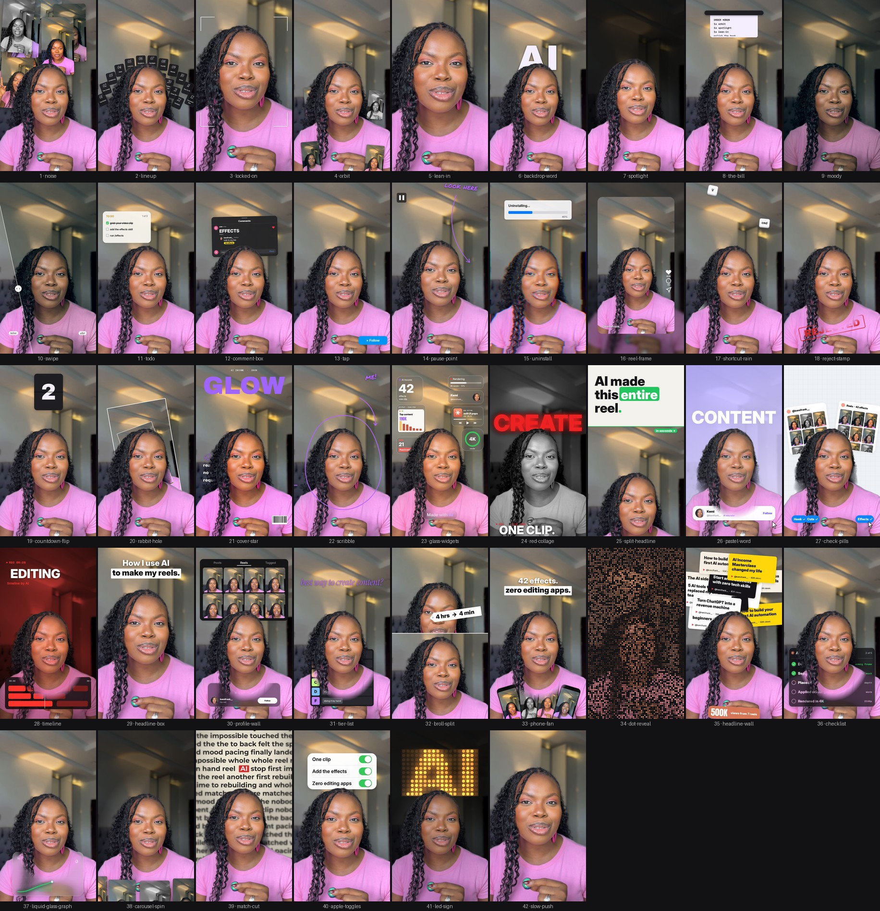

# Video Effects & Editing Toolkit for Claude

42 visual effects + auto-captions + dead-space cutting + B-roll insertion + color grading + speed ramps. Drop your video into Claude and tell it what you want.

Made by [@kemifrank__](https://instagram.com/kemifrank__) 💜



## Install (one line)

Open the Terminal app (or the terminal inside Claude Code) and paste:

```bash
git clone https://github.com/kemimosly-arch/kemi-video-effects ~/.claude/skills/effects
```

On Windows (PowerShell), use `$HOME\.claude\skills\effects` instead of `~/.claude/skills/effects`.

Then restart Claude Code. That's it.

> Not sure how? Open Claude Code and paste: **"Install the skill from github.com/kemimosly-arch/kemi-video-effects into ~/.claude/skills/effects"**. Claude will do it for you.

## Use it

1. Open Claude Code (the app or the terminal).
2. Drag your video into the chat.
3. Type the effect you want:

```
/effects orbit from 3 to 6 seconds
/effects spotlight when I say "kill the lights", with the word AI behind me
/effects comment-box at the end, typing EFFECTS
/effects glass-widgets for the first 3 seconds
```

The very first time, Claude sets itself up (about 2 minutes). It needs `ffmpeg` and Python, and it installs them for you if they're missing.

Claude checks a few frames first, fixes anything that covers your face, then renders `yourvideo_effects.mp4` right next to your original. Your audio stays as it was.

You can stack effects in one go: *"Add locked-on from 6 to 10s, then orbit from 10 to 13s, then a reject stamp on 'no'."*

## The 42 effects

| # | Type this | What happens |
|---|---|---|
| 1 | `noise` | Reels pile up behind your head |
| 2 | `lineup` | Numbered tiles fan out above your head |
| 3 | `locked-on` | Brackets lock onto your face and the camera follows you |
| 4 | `orbit` | Your reels circle your head, behind you at the top |
| 5 | `lean-in` | A quick punch-in on one word |
| 6 | `backdrop-word` | A giant word drops in behind you |
| 7 | `spotlight` | Kill the lights, keep you lit |
| 8 | `the-bill` | Your instructions print out like a receipt |
| 9 | `moody` | A moody colour grade |
| 10 | `swipe` | A before and after slider |
| 11 | `todo` | A checklist beside your head that ticks off as you talk |
| 12 | `comment-box` | An Instagram comment types itself and posts |
| 13 | `tap` | A Follow button flips to Following |
| 14 | `pause-point` | Freeze frame with a hand-drawn arrow |
| 15 | `uninstall` | A glitchy uninstall bar breaks the frame |
| 16 | `reel-frame` | Your video shrinks into a reel card |
| 17 | `shortcut-rain` | Keyboard keys rain down behind you |
| 18 | `reject-stamp` | A big red stamp slams down |
| 19 | `countdown-flip` | A 3, 2, 1 flip clock above your head |
| 20 | `rabbit-hole` | The room tunnels away behind you |
| 21 | `cover-star` | You become a magazine cover |
| 22 | `scribble` | Marker doodles draw themselves around you |
| 23 | `glass-widgets` | Frosted glass widgets and mini artifacts float around your head |
| 24 | `red-collage` | Black and white you, a giant red word behind, three lines slam in |
| 25 | `split-headline` | A headline card slides down and pushes you to the bottom half |
| 26 | `pastel-word` | Lavender room, a giant word behind you, a profile card gets followed |
| 27 | `check-pills` | Grid-paper room, your reels pinned behind you, blue pills get clicked |
| 28 | `timeline` | A dark red film look with an editing timeline and a glowing playhead |
| 29 | `headline-box` | A punch-in with a clean two-line headline |
| 30 | `profile-wall` | Your reels grid fills the wall while a counter ticks up |
| 31 | `tier-list` | A tier list drops in and AI flies into S tier |
| 32 | `broll-split` | B-roll on top with a price-tag sticker, you below |
| 33 | `phone-fan` | Your reels fan out like a hand of phones |
| 34 | `dot-reveal` | Your shot builds out of glowing dots, then snaps into focus |
| 35 | `headline-wall` | Your headlines pile up behind your head, then a total pops in front |
| 36 | `checklist` | A task list under your chin, each step ticks green |
| 37 | `liquid-glass-graph` | A liquid glass card with a graph that climbs and a number that counts up |
| 38 | `carousel-spin` | Your reels spin around you in a 3D carousel |
| 39 | `match-cut` | News pages cut on one word, locked in place behind your head |
| 40 | `apple-toggles` | iPhone switches flip on under your chin, one line at a time |
| 41 | `led-sign` | The lights drop and a glowing LED sign types itself out behind you |
| 42 | `slow-push` | A slow cinematic push-in while the room melts out of focus |

Bonus looks: `/effects glitter-spotlight` (golden rays and sparkles), `cover-star look=editorial` (a classic magazine cover) and `liquid-glass-graph look=bento` (a glass dashboard around you).

Every effect follows your face. Anything that would cover your face goes behind your head instead.

**Tips**
- Vertical phone videos with you in frame work best.
- Say the timing in plain words ("when I say 'watch'"). Claude finds the exact second.
- Want your own reels in `orbit`, `noise`, `phone-fan` or `profile-wall`? Give Claude a folder of screenshots.
- Charts, counters and headlines should use your real numbers. Tell Claude what they are.
- It renders in 1080p. Ask for 4K if you want it (slower).

---

## Auto-Captions

Add captions to your video with one command. 5 styles for different vibes.

```
python scripts/captions.py video.mp4 captioned.mp4 --style highlight --color purple
```

| Style | What it looks like |
|---|---|
| `word-pop` | One big word at a time, centered, with pop animation |
| `highlight` | Full sentence with current word highlighted in accent color |
| `karaoke` | Sentence fills in word-by-word, colored left-to-right |
| `clean` | Simple one-line subtitle at bottom |
| `bold-stack` | Two-line uppercase, punchy Instagram style |

Options: `--color`, `--font`, `--position top/center/bottom`, `--srt-in` (use existing SRT), `--srt-out` (export SRT).

---

## Dead-Space Cutting

Remove awkward pauses and silence from your talking videos.

```
python scripts/cuts.py cut-silence video.mp4 clean.mp4
python scripts/cuts.py jump-cut video.mp4 punchy.mp4 --max-gap 0.25
python scripts/cuts.py trim video.mp4 clip.mp4 --start 2.5 --end 10.0
```

| Command | What it does |
|---|---|
| `cut-silence` | Detects and removes silent gaps |
| `jump-cut` | Aggressive mode — removes all pauses for a punchy edit |
| `trim` | Simple start/end trim |

---

## B-Roll Insertion

Insert B-roll clips into your talking-head videos with transitions.

```
python scripts/broll.py pip main.mp4 output.mp4 --broll demo.mp4 --at 5.0 --duration 3.0 --corner br
```

| Mode | What it does |
|---|---|
| `cutaway` | Full-screen B-roll with fade transition |
| `pip` | Picture-in-picture in a corner |
| `split` | Top/bottom or left/right split screen |
| `overlay` | B-roll blended into background behind you |

Supports video and image B-roll. Use `--plan broll.json` for multiple insertions.

---

## Color Grading (12 Presets)

Apply a color grade to your whole video with one command.

```
python scripts/grade.py cinematic video.mp4 graded.mp4 --strength 0.8 --grain 0.02
```

Presets: `moody` · `warm` · `cool` · `film` · `pop` · `bw` · `vintage` · `cinematic` · `sunset` · `editorial` · `neon` · `pastel`

Extras: `--grain` (film grain), `--vignette` (darkened edges), `--letterbox` (cinemascope bars).

---

## Speed Ramps

Slow-mo, speed up, or timelapse any section of your video.

```
python scripts/speed.py slow-mo video.mp4 slowmo.mp4 --start 2.0 --end 4.0 --speed 0.3
python scripts/speed.py speed-up video.mp4 fast.mp4 --start 5.0 --end 8.0 --speed 2.5
python scripts/speed.py timelapse video.mp4 timelapse.mp4 --speed 4.0
python scripts/speed.py ramp video.mp4 output.mp4 --at 3.0 --duration 2.0 --speed 0.4
```

| Command | What it does |
|---|---|
| `ramp` | Smooth speed change at a specific moment |
| `slow-mo` | Slow down a section |
| `speed-up` | Speed up a section |
| `timelapse` | Speed up the entire video |

Use `--plan speed.json` for multiple speed ramps in one render.

---

## Honest notes
- These are **starter versions**. They draft, you approve. Watch the result before you post.
- For more AI content tips, follow [@kemifrank__](https://instagram.com/kemifrank__) or visit [ikemesitaliozor.com](https://ikemesitaliozor.com).

## If something goes wrong
Just tell Claude what you see ("the word covers my face", "it's too fast"). It will fix the plan and render again.

## Credits
Face tracking: [OpenCV YuNet](https://github.com/opencv/opencv_zoo) (MIT). Person cut-out: [MediaPipe Selfie Segmenter](https://ai.google.dev/edge/mediapipe/solutions/vision/image_segmenter) (Apache 2.0). Fonts: Archivo Black, Instrument Serif, Space Mono, Inter, Anton, Montserrat (SIL OFL) and Permanent Marker (Apache 2.0); licences are in `fonts/`. Everything else: MIT, see `LICENSE`.
