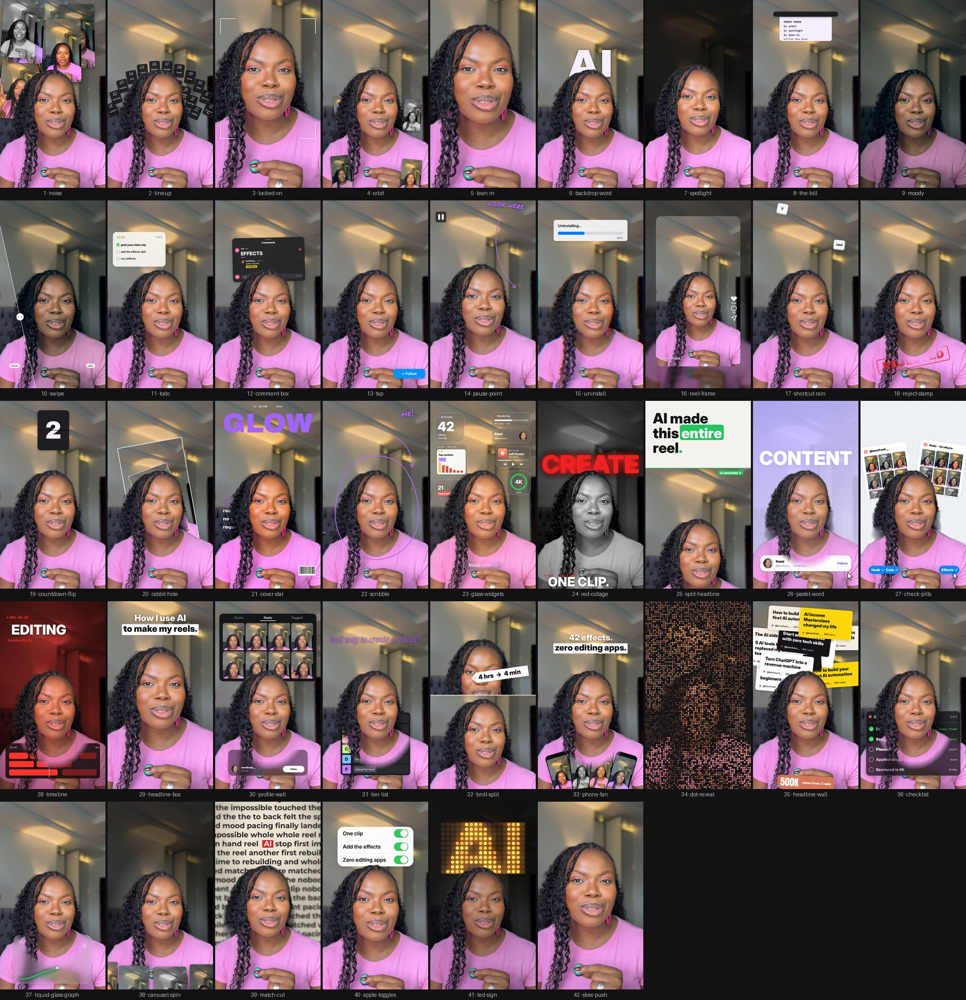

# Video Effects & Editing Toolkit for Claude

107 visual effects + 21 caption styles + 18 cute fonts + sound effects + dead-space cutting + B-roll insertion + color grading + speed ramps. Drop your video into Claude and tell it what you want.

Made by [@kemifrank__](https://instagram.com/kemifrank__) 💜



## Use it in the Claude app (claude.ai, desktop or phone)

1. Download **[effects.zip](https://github.com/kemimosly-arch/kemi-video-effects/raw/main/effects.zip)**. Use this file, not GitHub's green "Code → Download ZIP" button: that one contains the whole project (over 1,000 files) and Claude will refuse it.
2. In Claude, open **Customize → Skills**, click **+**, then **Upload a skill**, and choose `effects.zip`. Don't unzip it first.
3. Turn the skill on, start a chat, drag in your video and say what you want, e.g. *"/effects cut my mistakes, add captions and a clean zoom"*.

Code execution must be on (Settings → Capabilities) for the skill to run.

## Install in Claude Code (one line)

Open the Terminal app (or the terminal inside Claude Code) and paste:

```bash
git clone https://github.com/kemimosly-arch/kemi-video-effects ~/.claude/skills/effects
```

On Windows (PowerShell), use `$HOME\.claude\skills\effects` instead of `~/.claude/skills/effects`.

Then restart Claude Code. That's it.

> Not sure how? Open Claude Code and paste: **"Install the skill from github.com/kemimosly-arch/kemi-video-effects into ~/.claude/skills/effects"**. Claude will do it for you.

## Use it

1. Open Claude Code (the app or the terminal).
2. Drag your video into the chat.
3. Type the effect you want:

```
/effects orbit from 3 to 6 seconds
/effects spotlight when I say "kill the lights", with the word AI behind me
/effects comment-box at the end, typing EFFECTS
/effects glass-widgets for the first 3 seconds
```

The very first time, Claude sets itself up (about 2 minutes). It needs `ffmpeg` and Python, and it installs them for you if they're missing.

Claude checks a few frames first, fixes anything that covers your face, then renders `yourvideo_effects.mp4` right next to your original. Your audio stays as it was.

You can stack effects in one go: *"Add locked-on from 6 to 10s, then orbit from 10 to 13s, then a reject stamp on 'no'."*

## The 107 effects

| # | Type this | What happens |
|---|---|---|
| 1 | `noise` | Reels pile up behind your head |
| 2 | `lineup` | Numbered tiles fan out above your head |
| 3 | `locked-on` | Brackets lock onto your face and the camera follows you |
| 4 | `orbit` | Your reels circle your head, behind you at the top |
| 5 | `lean-in` | A quick punch-in on one word |
| 6 | `backdrop-word` | A giant word drops in behind you |
| 7 | `spotlight` | Kill the lights, keep you lit |
| 8 | `the-bill` | Your instructions print out like a receipt |
| 9 | `moody` | A moody colour grade |
| 10 | `swipe` | A before and after slider |
| 11 | `todo` | A checklist beside your head that ticks off as you talk |
| 12 | `comment-box` | An Instagram comment types itself and posts |
| 13 | `tap` | A Follow button flips to Following |
| 14 | `pause-point` | Freeze frame with a hand-drawn arrow |
| 15 | `uninstall` | A glitchy uninstall bar breaks the frame |
| 16 | `reel-frame` | Your video shrinks into a reel card |
| 17 | `shortcut-rain` | Keyboard keys rain down behind you |
| 18 | `reject-stamp` | A big red stamp slams down |
| 19 | `countdown-flip` | A 3, 2, 1 flip clock above your head |
| 20 | `rabbit-hole` | The room tunnels away behind you |
| 21 | `cover-star` | You become a magazine cover |
| 22 | `scribble` | Marker doodles draw themselves around you |
| 23 | `glass-widgets` | Frosted glass widgets and mini artifacts float around your head |
| 24 | `red-collage` | Black and white you, a giant red word behind, three lines slam in |
| 25 | `split-headline` | A headline card slides down and pushes you to the bottom half |
| 26 | `pastel-word` | Lavender room, a giant word behind you, a profile card gets followed |
| 27 | `check-pills` | Grid-paper room, your reels pinned behind you, blue pills get clicked |
| 28 | `timeline` | A dark red film look with an editing timeline and a glowing playhead |
| 29 | `headline-box` | A punch-in with a clean two-line headline |
| 30 | `profile-wall` | Your reels grid fills the wall while a counter ticks up |
| 31 | `tier-list` | A tier list drops in and AI flies into S tier |
| 32 | `broll-split` | B-roll on top with a price-tag sticker, you below |
| 33 | `phone-fan` | Your reels fan out like a hand of phones |
| 34 | `dot-reveal` | Your shot builds out of glowing dots, then snaps into focus |
| 35 | `headline-wall` | Your headlines pile up behind your head, then a total pops in front |
| 36 | `checklist` | A task list under your chin, each step ticks green |
| 37 | `liquid-glass-graph` | A liquid glass card with a graph that climbs and a number that counts up |
| 38 | `carousel-spin` | Your reels spin around you in a 3D carousel |
| 39 | `match-cut` | News pages cut on one word, locked in place behind your head |
| 40 | `apple-toggles` | iPhone switches flip on under your chin, one line at a time |
| 41 | `led-sign` | The lights drop and a glowing LED sign types itself out behind you |
| 42 | `slow-push` | A slow cinematic push-in while the room melts out of focus |
| 43 | `reel-cloud` | Your reels float around your head under a two-line headline in black boxes |
| 44 | `stacked-words` | Three words stack up behind your head, each in a different font |
| 45 | `word-rain` | Your word rains down behind you in every size |
| 46 | `outline-echo` | A giant word with outline echoes pulsing out behind your head |
| 47 | `neon-word` | A neon tube word flickers on behind your head |
| 48 | `script-word` | A word writes itself in pretty script behind your head |
| 49 | `bubble-word` | A squishy bubble-letter word bounces in behind your head |
| 50 | `sticker-word` | A word slaps on like a sticker beside your face |
| 51 | `letter-drop` | The letters of a word drop in one by one and bounce |
| 52 | `marquee` | A scrolling ticker band of your text runs behind you |
| 53 | `big-number` | A huge number counts up behind your head |
| 54 | `quote-card` | A glass quote card with your words slides up under your chin |
| 55 | `highlight-words` | Three key words pop up around your head in marker boxes |
| 56 | `side-titles` | Tall magazine titles run up both sides of the frame |
| 57 | `speech-bubble` | A comic speech bubble pops out beside your face |
| 58 | `thought-bubble` | A fluffy thought cloud floats above your head |
| 59 | `arrows-in` | Hand-drawn arrows sketch in from both sides, pointing at you |
| 60 | `doodle-crown` | A hand-drawn crown sketches itself onto your head |
| 61 | `sparkles` | Twinkling sparkles dance around your head |
| 62 | `confetti` | A burst of confetti pops and flutters down |
| 63 | `vhs` | A retro VHS look: scanlines, colour bleed and a REC timestamp |
| 64 | `light-leak` | A warm film light leak washes across the frame |
| 65 | `film-burn` | An orange film-burn flash, great as a transition |
| 66 | `bw-pop` | The room turns black and white while you stay in full colour |
| 67 | `color-room` | Your background turns one bold colour while you stay natural |
| 68 | `bokeh` | Soft glowing bokeh lights drift behind you |
| 69 | `dream-glow` | A soft, dreamy glow with lifted haze |
| 70 | `strobe` | Quick white flashes on the beat |
| 71 | `duotone` | The whole frame becomes a two-colour poster look |
| 72 | `portrait-blur` | Portrait mode: the background melts into soft blur |
| 73 | `rgb-glitch` | A digital RGB-split glitch with tearing bands |
| 74 | `shake` | A short handheld camera shake for impact (no zoom) |
| 75 | `flash` | A clean white flash, the classic cut transition |
| 76 | `polaroid` | Your shot shrinks into a tilted polaroid photo with a handwritten caption |
| 77 | `phone-frame` | You shrink into a phone screen, like a reel inside a reel |
| 78 | `window-frame` | You appear inside a desktop app window with traffic-light buttons |
| 79 | `film-strip` | Film-strip borders with sprocket holes roll down the sides |
| 80 | `cinema-bars` | Cinema bars slide in with a title, like a movie trailer |
| 81 | `grid-split` | Your shot multiplies into a 3x3 grid, then snaps back |
| 82 | `notifications` | Phone notifications stack in above your head, one by one |
| 83 | `dm-bubbles` | Chat bubbles pop in like a DM conversation beside you |
| 84 | `search-bar` | A search bar types your question, with suggestions dropping down |
| 85 | `poll` | A poll sticker appears and the votes fill up live |
| 86 | `progress-bar` | A glossy progress bar fills up with a label and percent |
| 87 | `stat-cards` | Three stat cards pop up in a row under your chin |
| 88 | `calendar` | A calendar page pops in and a date gets circled |
| 89 | `price-tag` | A price tag swings in on a string beside you |
| 90 | `before-after` | A BEFORE / AFTER split with a sliding divider and labels |
| 91 | `subscribe` | A red Subscribe button gets clicked, then a bell rings |
| 92 | `like-burst` | A big heart pops, then little hearts burst and float up |
| 93 | `star-rating` | Five stars fill in one after another with a rating |
| 94 | `timer-ring` | A circular countdown ring ticks down beside you |
| 95 | `email-pop` | A new email card slides down with a subject line |
| 96 | `quiz-card` | A quiz card appears and the right answer lights up green |
| 97 | `money-rain` | Bills and coins rain down behind you |
| 98 | `location-pin` | A map pin drops in with the name of a place |
| 99 | `now-playing` | A music player card with a moving waveform: now playing |
| 100 | `sticker-pack` | Cute stickers (heart, star, smiley, "wow") slap on around you one by one |
| 101 | `text-card` | Editorial: a full-screen cream or green card where serif words blur in as you speak |
| 102 | `serif-words` | Editorial: serif words blur in over your video, just below your chin |
| 103 | `split-card` | Editorial: a card on top with a title and list pills, your video slides into a rounded frame below |
| 104 | `dual-frame` | Editorial: a close-up of you on top and the wide shot below, like two cameras |
| 105 | `clean-zoom` | A smooth, eased zoom into your face that holds, drifts slightly, then eases back out |
| 106 | `stat-grid` | Editorial: a green card with a big number counting up over a grid that fills in |
| 107 | `cta-quote` | Editorial: Comment “WORD” in big serif with a small line under it, blurring in |

Bonus looks: `/effects glitter-spotlight` (golden rays and sparkles), `cover-star look=editorial` (a classic magazine cover) and `liquid-glass-graph look=bento` (a glass dashboard around you).

Every effect follows your face. Anything that would cover your face goes behind your head instead.

**Tips**
- Vertical phone videos with you in frame work best.
- Say the timing in plain words ("when I say 'watch'"). Claude finds the exact second.
- Want your own reels in `orbit`, `noise`, `phone-fan` or `profile-wall`? Give Claude a folder of screenshots.
- Charts, counters and headlines should use your real numbers. Tell Claude what they are.
- It renders in 1080p. Ask for 4K if you want it (slower).

---

## Captions (house style)

```
python scripts/captions.py video.mp4 captioned.mp4 --words video.words.json
```

The default `editorial` style: big lowercase white text sits just above your head, so your head passes in front of the words. The key word of each phrase (the punchline, a name or a number) switches to a pale-yellow italic serif on its own line. Words appear as you say them.

- `--emphasis "claude,edited"` picks the yellow words yourself.
- `--fix "ChargeGPT=ChatGPT"` fixes misheard words.
- `--fx-plan plan.json` moves the captions out of the way of your effects.

**Placement that never looks messy:** captions stay inside the Reels/TikTok safe zone (clear of the username, caption and side buttons), hold the same position from phrase to phrase, wrap into balanced lines with no lonely last word, and move below your chin on close-ups.

**19 more caption styles:** `bubbly`, `sticker`, `handwritten`, `candy`, `neon`, `boxed`, `marker`, `typewriter`, `luxe`, `retro`, `comic`, `soft-pill`, `wavy`, `cherry`, plus the classic `word-pop`, `highlight`, `karaoke`, `clean`, `bold-stack`. Example: `--style bubbly`.

---

## Sound Effects

25 synthesized sounds plus 12 designed sound packs (about 840 sounds, CC0), so there's nothing to download and nothing to license. They're mixed under your voice, never over it.

```
python scripts/sfx.py auto video.mp4 out.mp4 --fx-plan plan.json      # a matching sound for every effect
python scripts/sfx.py add video.mp4 out.mp4 --plan sfx.json            # sounds at exact times
python scripts/sfx.py list                                             # see them all
```

`whoosh` · `swoosh` · `whoosh-long` · `swipe` · `pop` · `bubble` · `tick` · `click` · `ding` · `chime` · `cash` · `impact` · `thud` · `stamp` · `riser` · `shimmer` · `typing` · `shutter` · `glitch` · `clunk` · `buzz` · `scribble` · `scratch` · `heartbeat` · `sub`

All of them are also in `assets/sfx/` as .wav files, ready to drag into CapCut.

---

## Clean Cut: fillers, mistakes and retakes

Record like a human, post like a pro. One command cuts every um, uh, stutter, false start and retake, and keeps the last take, the one you got right.

```
python scripts/clean.py video.mp4 clean.mp4 --dry-run     # see what it will cut
python scripts/clean.py video.mp4 clean.mp4               # cut it
python scripts/clean.py video.mp4 clean.mp4 --aggressive  # also "you know", "I mean", "basically"
```

You get the clean video, a `clean.review.txt` listing every cut with its reason, and `clean.words.json` (timings already matched to the cut, ready for captions). Changed your mind? `--keep 12-14` puts words back; `--cut 40-44` removes more.

---

## Dead-Space Cutting

Remove awkward pauses and silence from your talking videos.

```
python scripts/cuts.py cut-silence video.mp4 clean.mp4
python scripts/cuts.py jump-cut video.mp4 punchy.mp4 --max-gap 0.25
python scripts/cuts.py trim video.mp4 clip.mp4 --start 2.5 --end 10.0
```

| Command | What it does |
|---|---|
| `cut-silence` | Detects and removes silent gaps |
| `jump-cut` | Aggressive mode — removes all pauses for a punchy edit |
| `trim` | Simple start/end trim |

---

## B-Roll Insertion

Insert B-roll clips into your talking-head videos with transitions.

```
python scripts/broll.py pip main.mp4 output.mp4 --broll demo.mp4 --at 5.0 --duration 3.0 --corner br
```

| Mode | What it does |
|---|---|
| `cutaway` | Full-screen B-roll with fade transition |
| `pip` | Picture-in-picture in a corner |
| `split` | Top/bottom or left/right split screen |
| `overlay` | B-roll blended into background behind you |

Supports video and image B-roll. Use `--plan broll.json` for multiple insertions.

---

## Color Grading (Auto + 12 Looks)

**Auto** fixes your footage first: white balance (skin-safe), exposure, levels, highlight protection and gentle colour. There's no flicker, because it measures the whole clip once.

```
python scripts/grade.py auto video.mp4 graded.mp4
python scripts/grade.py auto video.mp4 graded.mp4 --look warm --look-strength 0.5
```

Or apply a look on its own:

```
python scripts/grade.py cinematic video.mp4 graded.mp4 --strength 0.8 --grain 0.02
```

Presets: `moody` · `warm` · `cool` · `film` · `pop` · `bw` · `vintage` · `cinematic` · `sunset` · `editorial` · `neon` · `pastel`

Extras: `--grain` (film grain), `--vignette` (darkened edges), `--letterbox` (cinemascope bars).

---

## Speed Ramps

Slow-mo, speed up, or timelapse any section of your video.

```
python scripts/speed.py slow-mo video.mp4 slowmo.mp4 --start 2.0 --end 4.0 --speed 0.3
python scripts/speed.py speed-up video.mp4 fast.mp4 --start 5.0 --end 8.0 --speed 2.5
python scripts/speed.py timelapse video.mp4 timelapse.mp4 --speed 4.0
python scripts/speed.py ramp video.mp4 output.mp4 --at 3.0 --duration 2.0 --speed 0.4
```

| Command | What it does |
|---|---|
| `ramp` | Smooth speed change at a specific moment |
| `slow-mo` | Slow down a section |
| `speed-up` | Speed up a section |
| `timelapse` | Speed up the entire video |

Use `--plan speed.json` for multiple speed ramps in one render.

---

---

## The web app

`app.py` is a simple web app around this toolkit. You upload a talking video and it cuts your fillers and mistakes, auto-corrects the colour, adds captions in safe positions, effects and sound effects, then you download the edited reel. Every step can be switched off or changed.

**Run it on your computer:** run `bash scripts/setup.sh` once, then `.venv/bin/python app.py`, and open http://localhost:7860.

**Put it online free on Hugging Face Spaces:**
1. Run `bash deploy/make_space.sh`. It builds `reel-editor-space.zip`.
2. On huggingface.co, click **New Space**, give it a name, choose **Gradio**, choose the free **CPU basic** hardware, then create it.
3. Open the Space's **Files** tab, click **Add file → Upload files**, drag in everything from inside the zip, then commit.
4. Optional: in **Settings → Variables and secrets**, add a secret named `ANTHROPIC_API_KEY`. With it, Claude reads each script and places the effects. Without it, a built-in planner picks the moments.

Settings you can change as variables: `MAX_SECONDS` (longest video allowed, default 90) and `WHISPER_MODEL` (`base` by default; `small` is more accurate but slower).

Editing is slow on CPU. In testing on 2 CPUs (the same as the free Space), a 10 to 16 second clip took about 6 minutes, so a 30-second video takes about 12 minutes and a 90-second one about 35. Paid hardware is much faster.

## Honest notes
- These are **starter versions**. They draft, you approve. Watch the result before you post.
- For more AI content tips, follow [@kemifrank__](https://instagram.com/kemifrank__) or visit [ikemesitaliozor.com](https://ikemesitaliozor.com).

## If something goes wrong
Just tell Claude what you see ("the word covers my face", "it's too fast"). It will fix the plan and render again.

## Credits
Face tracking: [OpenCV YuNet](https://github.com/opencv/opencv_zoo) (MIT). Person cut-out: [MediaPipe Selfie Segmenter](https://ai.google.dev/edge/mediapipe/solutions/vision/image_segmenter) (Apache 2.0). Fonts: Archivo Black, Instrument Serif, Space Mono, Inter, Anton, Montserrat (SIL OFL) and Permanent Marker (Apache 2.0); licences are in `fonts/`. Everything else: MIT, see `LICENSE`.
